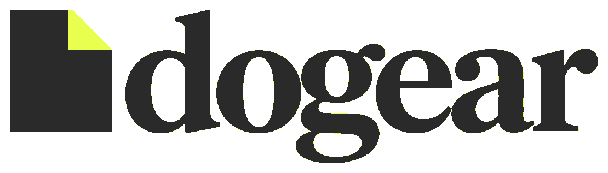
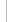

<div align="center">

<picture>
  <source media="(prefers-color-scheme: dark)" srcset="./public/readme/dogear-lockup-dark.png">
  
</picture>

### Paste a video. Learn from it.

<br>

<p align="center">
  <a href="https://tokenfactory.nebius.com" aria-label="Nebius Token Factory">
    <picture>
      <source media="(prefers-color-scheme: dark)" srcset="./public/readme/nebius-token-factory-dark.svg">
      
    </picture>
  </a>
  &nbsp;
  
  &nbsp;
  <a href="https://www.tavily.com" aria-label="Tavily">
    <picture>
      <source media="(prefers-color-scheme: dark)" srcset="./public/readme/tavily-full-dark.svg">
      
    </picture>
  </a>
</p>

<br>


</div>

Dogear turns long videos into a reading page. Paste a YouTube link, choose a level and why you are watching, and Dogear writes a chaptered guide from the transcript. Read it, highlight passages, ask questions, and jump back to the exact moment.

## What you get

- A chaptered guide from a YouTube video, with source timestamps.
- A level and purpose you choose before compiling.
- Highlight actions: explain, simplify, give an example, or open a source.
- A transcript you can click to jump through the video.
- Inline video controls for playback speed, captions, and notes.
- Diagrams and recall questions where a chapter needs them.

## Quick start

```bash
git clone https://github.com/tonykipkemboi/dogear.git
cd dogear
npm install
npm run dev
```

Open [http://localhost:5173](http://localhost:5173).


### Requirements

- Node 20.19 or newer
- `yt-dlp` on your `PATH` for new videos
- A Nebius Token Factory key for live questions and compiling
- A Tavily key for live web research

## Keys

Open **Keys** from the header, the mobile tab bar, or `/settings`. Keys are stored in the macOS Keychain. The browser never receives a stored key.

For self-hosting, set `NEBIUS_API_KEY` and `TAVILY_API_KEY` in the environment.

## How it works

1. Paste a YouTube link.
2. Choose a reading level and a purpose.
3. Dogear reads the transcript and writes a guide.
4. Read, highlight, ask, or jump back to the video.

## Project map

```text
dogear/
├── AGENTS.md            Agent setup, verification, and handoff guide
├── src/                 React app, reader, highlights, transcript
├── server/              Local API, guides, Tavily, Nebius, compiler
├── scripts/             macOS Keychain helper
├── public/              Brand assets and demo frames
├── tests/               Playwright browser flows
└── data/library/        Compiled guides (gitignored)
```

## Scripts

| Command | What it does |
| --- | --- |
| `npm run dev` | Start the API and Vite together |
| `npm run build` | Typecheck and build the production app |
| `npm start` | Serve the build and API on port 8787 |
| `npm test` | Run unit tests |
| `npm run test:e2e` | Run browser flows |
| `npm run typecheck` | Typecheck the app |

## Verification

- 24 unit tests
- 18 Playwright flows
- Production build and deep links verified
- Live Tavily search verified

## Current limits

- New videos must have English captions on YouTube.
- Compiling requires a Nebius Token Factory key.
- File upload and playlist compilation are not implemented.
- Compiled guides live on the local machine. There is no account system or sync yet.

---

<div align="center">
  <em>This was built using DeepSeek V4.1 Flash 1017, served by <a href="https://tokenfactory.nebius.com">Nebius Token Factory</a>. The app runs locally for now and is still a work in progress.</em>
</div>
